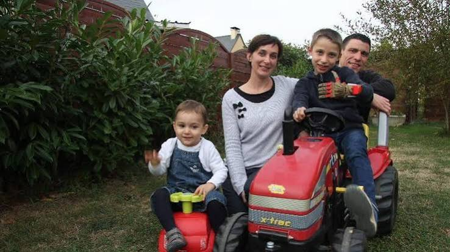

# Page de presentation de Nolann GUEHO

Je m'appelle Nolann, je suis actuellement en B1 à SupDeVinci. 
J'abitte a Mouzeil, je fait donc le trajet tout les jours et pour economisé du carburant, je fait du convoiturage avec mon père se qui me fait donc arriver en avance a l'école.

Les choses que j'ai apprises sur Git :
- Géré un projet avec des backups
- Avoir un projet en ligne pour pouvoir le modifier à plusieurs simplement
- Pouvoir accéder et participer aux GitHub communautaires

[Retourner au menu](README.md)